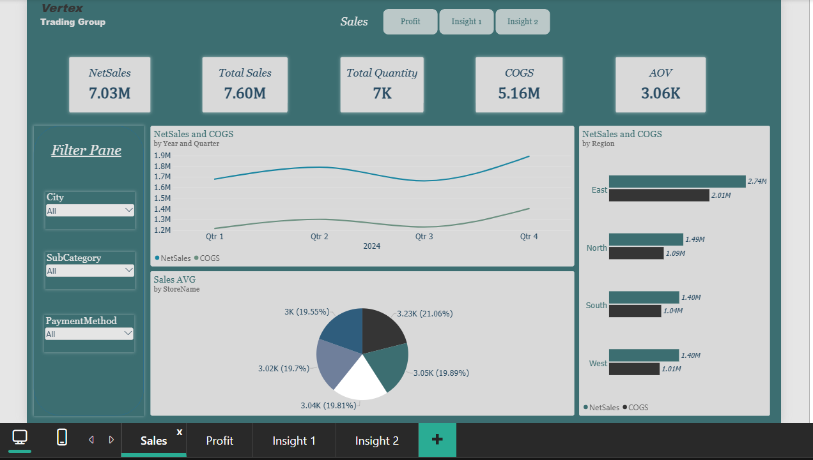
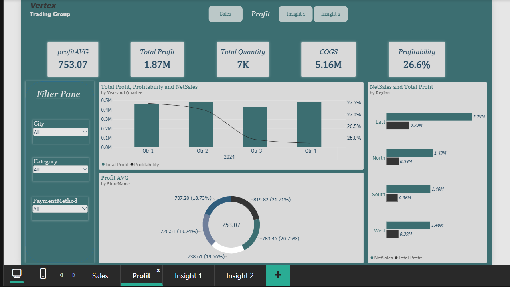
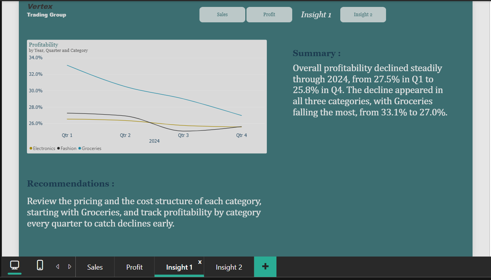
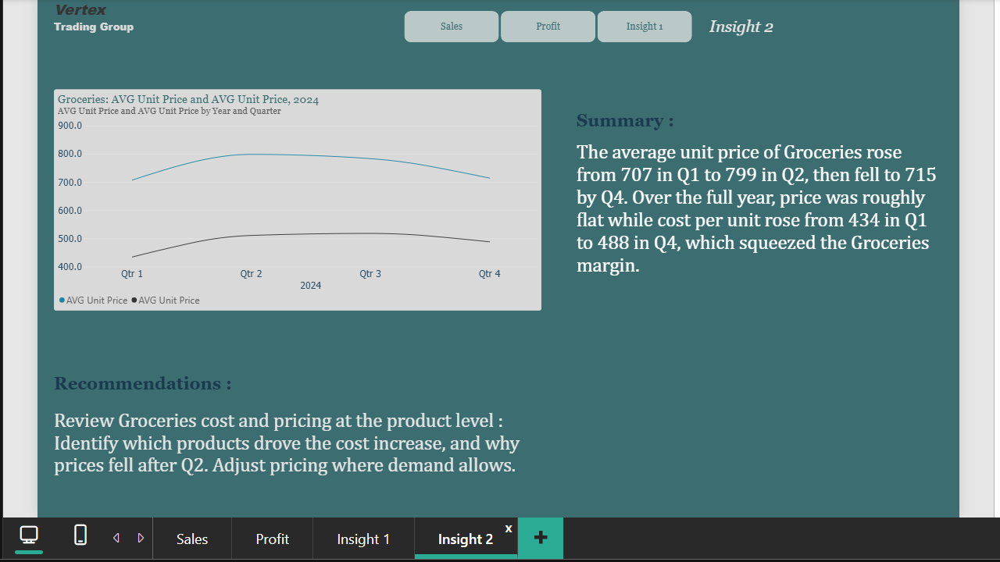

# Retail Sales Analysis Dashboard

An interactive Power BI dashboard analyzing sales and profits in 2024

## Project Overview

This project covers a full data analysis workflow:
1. **Data Cleaning** using Excel (Power Query)
2. **Interactive Dashboard** using Power BI

## Tools Used

- **Excel (Power Query)** - Data cleaning and transformation
- **Power BI Desktop** - Dashboard building and DAX calculations

## Workflow

### 1. Data Cleaning (Power Query)
- Converted date columns from Whole Number to proper Date data type
- Fixed customer gender values using a Conditional Column
- Applied "Use First Row as Headers" to correct column names

### 2. Dashboard (Power BI)
Built 4 interactive dashboards covering different aspects of the data, including sales, profit performance and key business metrics.

## Key Insights
- **1. Profitability declined through 2024**
Overall profitability fell from 27.5% in Q1 to 25.8% in Q4. The decline appeared in all three categories, with Groceries falling the most, from 33.1% to 27.0%.

- **2. Groceries margin was squeezed**
The average unit price of Groceries rose from 707 in Q1 to 799 in Q2, then fell to 715 by Q4. Over the full year, price was roughly flat while cost per unit rose from 434 in Q1 to 488 in Q4.

## Recommendations
- Review the pricing and the cost structure of each category, starting with Groceries
- Track profitability by category every quarter to catch declines early.
- Review Groceries cost and pricing at the product level : Identify which products drove the cost increase, and why prices fell after Q2.

## Files in this Repository

| File | Description |
|---|---|
| `retail_sales_dataset.xlsx` | Raw data before cleaning |
| `retail_sales_cleaned.xlsx` | Cleaned data after Power Query transformations |
| `retail_sales.pbix` | Full Power BI dashboard file |
| `dashboard1_preview.png` | Preview of Dashboard 1 |
| `dashboard2_preview.png` | Preview of Dashboard 2 |
| `dashboard3_preview.png` | Preview of Dashboard 3 |
| `dashboard4_preview.png` | Preview of Dashboard 4 |

## Dashboard Previews

### Sales Dashboard

### Profit Dashboard

### Insight 1 Dashboard

### Insight 2 Dashboard

## Power BI Measures

- **Total Sales**: Sum of all sales transactions
- **Total Sales AVG**: Average sales value
- **Total Profit**: Sum of profit across all transactions
- **Profit AVG**: Average profit value
- **Net Sales**: Calculated as Price × Quantity × Discount
- **COGS**: Cost of Goods Sold
- **Profitability**: Total Profit divided by Net Sales (profit margin)
- **AOV (Average Order Value)**: Average amount spent per order
- **% of Total Sales**: Each item's contribution as a percentage of total sales
- **Customer Rank (CUS.Rank)**: Ranks customers based on their total sales
- **Product Rank (Prod.Rank)**: Ranks products based on total sales
- **Store Rank**: Ranks stores based on total sales
- **Frequent Customers**: Counts how many times each customer made a purchase
- **Best Payment Method**: Counts occurrences of each payment method to identify the most used one
- **Product Mix**: Each product category's share of total sales, showing how much every category contributes to overall revenue. Respects other report filters (such as date), but ignores the category filter so each category is compared against the total of all categories
- **Avg COGS per Unit**: The average cost of goods sold for each unit sold: total COGS divided by total quantity sold
-  **Avg Unit Price**: The quantity-weighted average catalog price of the units sold: each product's list price is multiplied by the quantity sold, summed, and divided by total quantity. Products that sell more units therefore influence the average more
